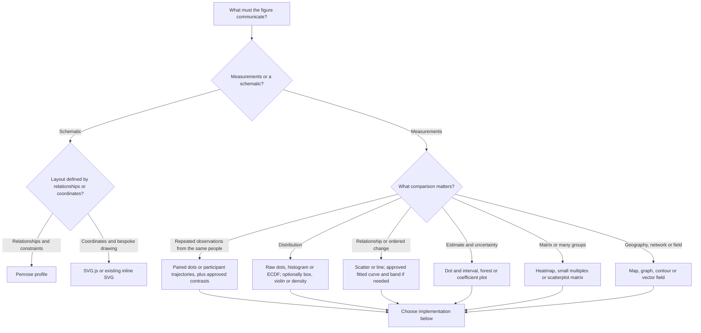
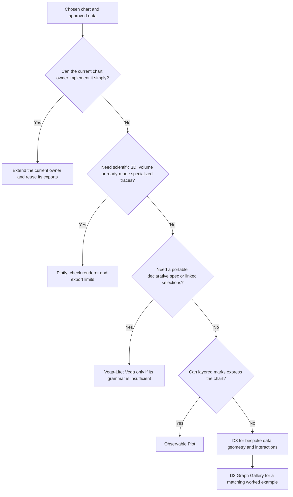

# Choosing scientific web figures

Read this guide before choosing or changing a chart family or visualization
library. It is agent guidance, not shipped plotting code. Reuse the existing
chart/data owner first; these references do not install seven libraries or
authorize new analyses. Scientific contracts in [PROJECT.md](../PROJECT.md)
and gates in [VERIFICATION.md](../VERIFICATION.md) remain authoritative.

## Start with the data and question

Record the observational unit, variables/units, repeated-measure IDs, grouping,
missingness, approved estimate/interval source, intended comparison, interaction
needs and export requirements. A chart library's default aggregation is not an
analysis specification. If the requested estimand or interval is unresolved,
use the statistical-analysis route before generating inferential graphics.

| Data/question | First candidate | Additional options and selection rule |
| --- | --- | --- |
| One quantitative variable | Raw dot/strip plot and histogram or ECDF | Box/violin/ridgeline for grouped distributions; disclose KDE bandwidth and binning. Sparse data favor actual points over smooth shapes. |
| Repeated observations or two paired conditions | Paired dots/lines and a difference plot | Spaghetti across ordered visits/SOAs; small multiples if lines obscure people. A pooled violin alone hides pairing. |
| Independent categorical groups × numeric outcome | Dots with approved summary/interval | Box, violin, raincloud composition; show n and identify the unit. Bars suit counts better than hiding continuous observations. |
| Two numeric variables | Scatterplot | Hexbin, 2D histogram or density contours for overlap; bubble area for a third numeric value; label any fitted relationship. |
| Ordered distance, SOA, block or time | Dots and ordered line | Step for piecewise-constant quantities; uncertainty ribbons for approved curves; gaps for missing measurements. No arbitrary connections between unordered categories. |
| Condition × Phase or other factorial comparison | Interaction plot and contrasts | Facet by a factor; separate interval plots for main effects and interactions. Crossing lines alone are not an interaction test. |
| Estimates with intervals | Dot-whisker / coefficient / forest plot | Multiple interval levels if defined; paired contrasts preserve covariance. SD, SEM, CI, credible and prediction intervals need different labels. |
| Posterior or sampling distribution | Density, histogram, ECDF and interval summary | Joint scatter/contours for dependence; propagate draws rather than treating posterior medians as independent observations. |
| Model adequacy or calibration | Observed-versus-predicted and residual plots | QQ, predictive-check overlays, calibration curve; use existing diagnostics, not visual fit as an identification guarantee. |
| Many outcomes/subscales | Facets or dot-whisker rows | Correlation heatmap, parallel coordinates or scatterplot matrix when appropriate; preserve units and disclose missing-data handling. |
| Ordinal questionnaire responses | Ordered count/proportion bars | Diverging stacked Likert bars with declared neutral category; no numeric distances implied without justification. |
| Missingness | Presence/absence matrix and missing counts | Keep absent, excluded, failed and observed zero distinct; never silently interpolate. |
| Counts, ranks or signed changes | Bar, dot, lollipop or waterfall | Preserve zero and signs; ranks can use bump charts over ordered time. |
| Composition or hierarchy | Stacked bars, treemap, icicle or partition | Pie/donut/waffle only for a genuine common whole; negative values do not form slices. |
| Relationships/flows | Node-link, adjacency matrix or Sankey | Chord/arc/edge bundling as alternatives; distinguish measured flow from generic association and drawn geometry from physical space. |
| Geographic observations | Point/bubble map or choropleth | Use correct CRS/projection and rate denominators; hexbin for spatial density. Geography is unnecessary for non-spatial categories. |
| Scalar grid or field | Heatmap or contours | Surface/volume only when depth helps the question; supply a readable 2D/static alternative. |
| Directional/vector data | Arrow/quiver field or polar plot | Normalize or scale lengths explicitly; keep directional cyclic order. |
| Durations, intervals or survival | Timeline/Gantt or precomputed step survival curve | Preserve censoring and risk-set definitions; a plotting library does not estimate a valid survival model. |
| Experimental apparatus, logic or geometry | Annotated inline SVG or constraint diagram | SVG.js for coordinate-driven drawings; Penrose for semantic constraints. Schematic distances need a scale or an explicit not-to-scale label. |

These are project selection recommendations, not claims that every toolkit has
each chart built in. The profiles below identify native primitives, compositions,
examples and limitations.

## Then choose the implementation

| Profile | Approach and best reason to select it | SVG/CSS and complexity boundary |
| --- | --- | --- |
| [Observable Plot](observable-plot.md) | Compose marks, transforms and facets for tabular scientific figures | SVG, sometimes wrapped in HTML; style via options/CSS. Built-in statistical transforms must not silently replace approved estimates. |
| [Vega-Lite](vega-lite.md) | Declare marks/encodings, layers and coordinated views in a JSON specification | Select SVG rendering explicitly for vector needs; style via specification/config. Escalate to Vega only for a concrete grammar limitation. |
| [D3](d3.md) | Assemble scales, shapes, layouts and data joins for a custom chart | SVG/HTML or canvas; greatest geometric control, more implementation responsibility. |
| [D3 Graph Gallery](d3-gallery.md) | Adapt a complete worked example | Tutorial source, not another chart runtime; examples have different D3 versions. |
| [Plotly.js](plotly.md) | Select named traces and configure layout, subplots and interaction | SVG, WebGL and mixed renderers; use the figure API for styling. An SVG export can contain raster content. |
| [Penrose](penrose.md) | Describe semantic objects and optimize their visual constraints | SVG/PDF schematic generation; specialized languages, not a statistical engine. |
| [SVG.js](svgjs.md) | Build coordinate-driven vector drawings from SVG elements | Direct SVG/CSS control; no built-in axes, uncertainty calculation or statistical chart menu. |

For HTML layout and controls, combine the existing `uncodixfy-pretext` and
accessibility routes from [SKILLS.md](../SKILLS.md). Do not add framework,
notebook, plugin or backend dependencies just to use a chart example.

## Study 5 application

- SOA/phase/block figures: preserve participant-level pooling and pairing. Reuse
  `workbook/pivot_assets/` and `workbook/overview_assets/` owners; inspect the
  actual owner before editing. Native saved results remain labelled as such.
- Current primary RT analyses use AT minus the matched participant × Condition ×
  Phase baseline; Segment 0's benefit display deliberately reverses that sign.
  Preserve the active contract and label the measure; do not infer sign from a
  chart recipe. Keep Condition × Phase cells and primary40/linkage sensitivities.
- Live quantitative plots render from approved data using native web elements;
  an exported SVG/PNG in an image element does not satisfy the live-chart rule.
  Schematics and static downloads have their own purposes.
- Retain actual zero as specified in `PROJECT.md`, all observed/interval extents,
  missing gaps, readable units, accessible non-color encodings, keyboard/touch
  value access and the same full-precision data behind table/chart/download.
- A smoother, violin KDE or fitted S adds assumptions. Keep observations visible,
  identify imposed geometry and do not refit or choose a model through this guide.

## Source inventory and completeness

[catalog.json](catalog.json) is a machine-readable, read-only extraction observed
on **2026-10-23**. Each toolkit records its exact GitHub commit, source scope,
repository URL, non-truncated tree receipt, package version where present, and
SHA-256 receipts for source files actually fetched. Source URLs are reconstructed
as `source_base + source_path` (or a listed example path). Pins are research
snapshots, not runtime locks or a claim that a stable release was installed.

| Toolkit | Exhaustively extracted finite surface at its pin |
| --- | --- |
| Observable Plot | Public exports from 30 mark source files (31 export groups, including raster helpers), 13 transform source files and pointer interactions |
| D3 | All 30 modules exported by the umbrella package |
| D3 Graph Gallery | All 40 local landing-page links (37 chart families and 3 instructional pages), plus 165 `graph/*.html` examples |
| Vega-Lite | All 14 primitive and 3 composite marks, 203 featured gallery entries and 816 example specifications |
| Plotly.js | All 47 trace modules and their source-declared categories |
| Penrose | All 194 example trios across 46 top-level folders, and 53 featured gallery IDs |
| SVG.js | All 30 public element classes and their element source paths |

No finite catalogue can enumerate every chart composed from SVG primitives,
marks or constraints. This inventory covers the declared source surfaces, not
every styling property, possible composition, external plugin or future release.
Example counts are not counts of independent chart types; unfeatured examples
can be variants or tests. Consult the selected toolkit's linked documentation
for per-mark properties, channels, scales and current compatibility.

Refresh only when a task needs newer capabilities: fetch an explicit new commit,
repeat these extraction scopes, compare additions/removals, update the matching
profile and counts, and rerun the documentation gates. Never execute upstream
examples or install plugins as part of merely refreshing this reference.

## Selection record and checks

In the existing task plan/evidence owner, record: question and data unit; chosen
plot/encodings; toolkit or reused owner; native versus composed implementation;
estimate/interval provenance; missingness and pairing; renderer; interaction and
static fallback; source pin/example; validation. Do not create a second ledger.

For this guide, verify local links/anchors, JSON parsing, pinned inventory
coverage and context/diff gates. For a real chart change, run the relevant
numerical, rendering, accessibility, export and publication gates in
[VERIFICATION.md](../VERIFICATION.md); a catalogue entry proves none of them.
