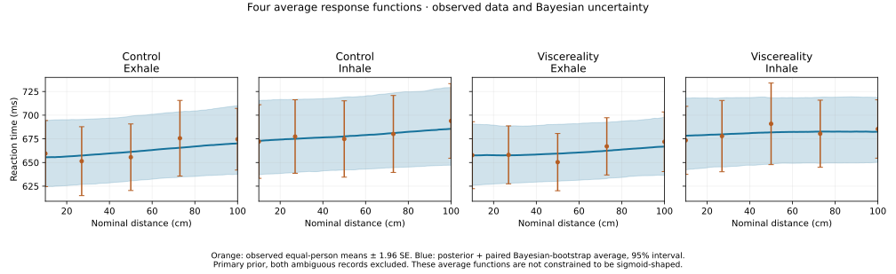
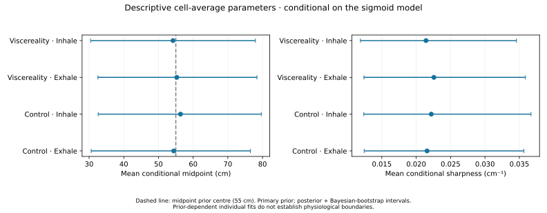
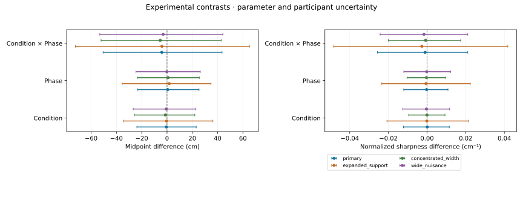

# Study 5 — results before manuscript narrative

Analysis snapshot: 17 October 2026. This report answers the ordered questions in
[the analysis roadmap](../for-ai/ANALYSIS_ROADMAP.md). It does not select the paper
narrative or update manuscript prose. The earlier version-1.9 analysis and paper
are preserved; the Bayesian results are a separate exploratory extension.

## Completion by analysis level

| Level | Work completed | Scientific conclusion / remaining limit |
| --- | --- | --- |
| 0. Data and preprocessing | **VERIFIED:** public-data audit, fixed cleaning, scoring, timing and recording-exclusion sensitivities | **BLOCKED:** P011/P033 source mapping remains unresolved |
| 1. Individual shape and reliability | **VERIFIED computations:** extraction/smoothing search, prediction, split halves, recovery and Bayesian prior-information checks | **PARTIAL scientific goal:** reliable observed sigmoid shapes are not established for all individuals |
| 2. Two participant × condition parameters | **VERIFIED computations:** midpoint and normalized sharpness posteriors for all 168 cells under four priors, plus earlier regularized estimates | **PARTIAL scientific goal:** finite estimates are available, but individual physiological boundaries/sharpness remain poorly identified |
| 3. Condition, breathing phase and interaction | **VERIFIED computations:** paired contrasts, prior/cohort sensitivities and uncertainty propagation | **INCONCLUSIVE:** no robust parameter difference established; this is not an equivalence result |
| 4. Average response and parameter figures | **VERIFIED:** four average functions, cell-average conditional parameters, contrasts and participant atlas | Figures retain raw evidence and prior uncertainty; average functions are not forced to appear sigmoid-shaped |
| 5. Spatial ratings, eight MAIA dimensions and joint interactions | **VERIFIED computations:** earlier tests plus new posterior/resampling analyses, all scales and effects retained | No reliable PPS association or joint interaction established; separate spatial-rating/Trusting findings described below |
| 6. Reproducibility and handoff | **VERIFIED:** independent numerical checks, actual browser computation/download, full numerical parity and visual review; live publication status is linked below | The full joint hierarchical nonlinear model is **NOT RUN**; the implemented Bayesian reference is unpooled and explicit about its assumptions |

A completed, inconclusive analysis counts as computational completion. It does
not make an unidentified parameter a validated measurement. Checked checklist
items denote work performed, not a required positive result.

## 0. What data can answer the questions?

There are 42 participant records and 17,114 recorded trial rows. Fixed cleaning
retains 8,916 Audio–Tactile RTs. The new primary behavioural analysis excludes both
ambiguous recordings, leaving 40 records and 8,478 retained Audio–Tactile RTs;
39 of those records have complete questionnaire/spatial data. Questionnaire-only
analyses use 41 complete records and do not depend on RT-recording linkage.

P011 and P033 contain the same 408 behavioural rows with condition labels swapped
and different questionnaire records. All source rows are preserved. The full
cohort and each single exclusion remain sensitivities. Exact recording copies
share posterior draws and recording-group resampling weights; they are not treated
as independent RT evidence. Exclusions cannot identify the correct mapping.

MAIA-2 was completed once before the experiment. Spatial-frame ratings were given
after each intervention, once per condition, not once per respiratory phase.
Spatial delta is Viscereality minus Control. Numerical category changes assume
comparable spacing. The administered pictogram anchor key is unavailable, so
higher codes cannot be called more allocentric or egocentric. Physiological belt
compliance, waveform timing and other absent source metadata remain unavailable.

## 1. Can we obtain an individual sigmoid, and is it reliable?

**We can compute a sigmoid approximation for every cell; we cannot establish a
reliable physiological sigmoid in every cell.** The original trial-level criterion
passed in 0/168 cells. That threshold alone is not a universal test of latent mean
shape; the separate prediction, posterior-information and reliability results are
needed to assess the new estimates.

The earlier uniform searches compared extraction, local smoothing, broad/visible
sigmoids, shared plateaus, lines and constants. They can generate visible model
geometry, but its constraints and normalization do not create observed curvature.
The new Bayesian reference fits the unsmoothed retained RTs and allows flat or
reversed responses through a signed amplitude with no nonzero floor.

Under the primary Bayesian prior, among the 160 non-ambiguous cells:

- **0/160** midpoint 95% intervals lie wholly inside the measured 10–100 cm range.
- **5/160** signed-amplitude intervals exclude zero.
- Median joint shape information gain is **0.108 nats**, indicating little updating
  relative to the declared shape prior.
- Median posterior probability that both 10–90% bends lie inside the measured
  range is **0.0615**.
- Median midpoint interval width is approximately **173 cm**; expanding the shape
  support increases it to approximately **259 cm**.

Ten new random split halves give condition-change rank reliability of **0.032**
for midpoint and **−0.134** for sharpness. Four-cell-mean reliability is **0.156**
and **0.150**, respectively. These are within-session diagnostics, not test–retest
reliability. In 20 matched-Gaussian simulations with true 80-ms sigmoids, median
parameter-recovery rho is **0.456** for midpoint and **0.0435** for sharpness.
Recovery under that assumed signal does not validate the real data; it shows that
sharpness is difficult to recover even in this favourable simulation.

Held-distance prediction RMSE is **47.44 ms** for the primary Bayesian sigmoid,
**48.03 ms** for a constant, **52.13 ms** for a line and **54.48 ms** for log distance.
The sigmoid-minus-constant difference is **−0.59 ms**, paired-person 95% interval
**[−2.45, 1.13] ms**. Thus the sigmoid improves on a line but does not clearly
outperform a constant. Predicting reasonably well does not identify its boundary.

## 2. What exactly are the Bayesian parameter estimates?

For each participant and four cells, the model is a signed logistic RT response
with midpoint m, positive width w, baseline and amplitude. The two target
parameters are **m in cm** and **normalized midpoint sharpness 1/(4w) in cm⁻¹**.
RT amplitude and the signed RT derivative are different quantities.

This is a genuine quadrature approximation to an explicitly defined posterior:
Gaussian trial likelihood; proper normal–inverse-gamma nuisance priors; finite-grid
midpoint/width integration. Four shape/nuisance priors are retained and none is
selected using questionnaire significance or figure appearance. Posterior medians
are absolute-loss point summaries within those models, not an assumption-free or
universally best estimate. The [fixed specification](../workbook/ANALYSIS_PLAN.md)
and [Bayesian detail](bayesian/bayesian_results.md) document the model and checks.

All **168 × 4 = 672** individual fits are available, with posterior intervals,
signed amplitudes, predictive discrepancy, prior information and boundary mass.
The fine-grid check changes individual midpoint medians by at most **0.0374 cm**
and sharpness medians by at most **0.00000865 cm⁻¹**. Numerical precision is good;
measurement precision remains poor.

The Gaussian prior-predictive distribution permits negative RTs: approximately
3% under the main prior and 12.5% under the deliberately wider nuisance prior.
This is an explicit working-model limitation. Positive-support/heavy-tail and
serial-dependence likelihood sensitivities and a full joint hierarchical nonlinear
model have **not** been implemented by this reference. Partial pooling could add
stability, but would require its own prior, predictive, convergence and recovery
checks; a narrower interval from pooling alone would not establish identification.

## 3. Do the two parameters differ across the experiment?

The main comparison uses the 40-record cohort, all four paired cells, and carries
individual posterior draws into the contrasts. The table includes a paired
Bayesian-bootstrap participant-weight sensitivity. These intervals describe a
modular posterior/resampling analysis, not a fully hierarchical population-effects
posterior. Finite-cohort posterior intervals are exported separately.

| Effect | Parameter | Median [95% interval] | Probability above zero |
| --- | --- | --- | ---: |
| Condition | midpoint_cm | -0.532 [-23.8, 23.1] | 0.48 |
| Condition | normalized_steepness_per_cm | 0.000101 [-0.0122, 0.0115] | 0.51 |
| Phase | midpoint_cm | 0.565 [-23.2, 25.3] | 0.52 |
| Phase | normalized_steepness_per_cm | -0.000217 [-0.0121, 0.0108] | 0.49 |
| Condition × Phase | midpoint_cm | -4.1 [-50.5, 43.5] | 0.44 |
| Condition × Phase | normalized_steepness_per_cm | -0.00101 [-0.0257, 0.021] | 0.46 |

Condition = Viscereality−Control, averaging the two phases. Phase = Inhale−Exhale,
averaging the conditions. Interaction = the difference of the two phase effects.
Midpoint units are cm; sharpness units are cm⁻¹. The conclusion is **no robust
parameter difference established**, with broad uncertainty. Every primary contrast
interval also includes zero under the three alternative priors. This does not
establish that the conditions are equivalent.

### Conventional tests on one Bayesian estimate per participant and cell

The owner additionally requested ordinary statistical tests on the Bayesian
approximations, treating each extracted value as fixed. This analysis takes the
**marginal posterior median** of boundary and normalized sharpness from every
participant × condition × phase cell and runs two conventional **2 × 2
repeated-measures ANOVAs**. It uses the primary prior and the same 40-record cohort,
with no fit-quality exclusions, transformation, posterior weighting or multiple
testing correction. Every one-df effect is equivalent to the squared t test of
its paired participant contrast. All tests below have **F(1,39)**.

| Parameter | Effect | Mean difference [conventional 95% CI] | F | Unadjusted p | Partial η² |
| --- | --- | --- | ---: | ---: | ---: |
| Boundary (cm) | Viscereality−Control | −2.196 [−6.879, 2.488] | 0.899 | .349 | .0225 |
| Boundary (cm) | Inhale−Exhale | +1.250 [−3.333, 5.833] | 0.304 | .584 | .0077 |
| Boundary (cm) | Condition × Phase | −5.763 [−16.246, 4.721] | 1.236 | .273 | .0307 |
| Sharpness (cm⁻¹) | Viscereality−Control | −0.00000919 [−0.000940, 0.000921] | 0.000399 | .984 | .0000102 |
| Sharpness (cm⁻¹) | Inhale−Exhale | −0.000713 [−0.001705, 0.000279] | 2.111 | .154 | .0514 |
| Sharpness (cm⁻¹) | Condition × Phase | −0.000758 [−0.003135, 0.001619] | 0.416 | .523 | .0106 |

**None of the six primary tests is significant at unadjusted .05.** This remains
true across all 96 terms from the four existing prior and four cohort
specifications (minimum p=.0884). The full 42-record specification is provisional
because it retains both linked recordings; its standard errors do not establish
independent-participant inference.

For descriptive context, averages of the individual posterior medians are:

| Cell | Boundary (cm) | Sharpness (cm⁻¹) |
| --- | ---: | ---: |
| Control · Exhale | 54.20 | 0.01036 |
| Control · Inhale | 58.33 | 0.01003 |
| Viscereality · Exhale | 54.88 | 0.01073 |
| Viscereality · Inhale | 53.25 | 0.00964 |

These are means of marginal posterior medians, whereas the previous table uses
contrasts of posterior draws. Nonlinear/skewed posteriors mean those summaries
need not coincide. The conventional intervals include only the variation between
participants' point estimates and omit uncertainty within their individual fits.
They cannot establish that the physiological parameters have been reliably
measured. Sharpness contrast distributions also depart from normality (Shapiro–Wilk
p=.000593, .00000179, and .0262 for Condition, Phase, and interaction); the requested
ANOVAs are retained without selecting another test. These results are distinct
from the old regularized-fit ANOVAs below. No equivalence conclusion follows.

The [full conventional ANOVA table](bayesian/bayesian_point_estimate_anova.csv)
retains every effect, prior, cohort, confidence interval and normality diagnostic.

### Why the earlier small ANOVA p values are not sufficient

The earlier repeated-measures ANOVAs condition on shrunken/shape-constrained point
estimates. Eleven of twelve conventional tests have p < .05 in the primary cohort,
but **all twelve curve-refit intervals include zero**. The estimates are not
independent error-free measurements, and shared pooling can make their conventional
standard errors artificially small for the physiological question. Those numerical
results remain available; they should not be selected as dependable condition effects.

| Earlier plateau model | Effect | Parameter | Point estimate | Conventional p | 95% curve-refit interval |
| --- | --- | --- | ---: | ---: | --- |
| individual_plateaus | Condition | midpoint_cm | -16.1 | 2.3e-43 | [-28.2, 18.2] |
| individual_plateaus | Condition | normalized_steepness_per_cm | 0.00212 | 2.65e-10 | [-0.0198, 0.0265] |
| individual_plateaus | Phase | midpoint_cm | -15.1 | 1.19e-39 | [-27.7, 17] |
| individual_plateaus | Phase | normalized_steepness_per_cm | 0.00332 | 3.51e-17 | [-0.0219, 0.0277] |
| individual_plateaus | Condition × Phase | midpoint_cm | -40.2 | 1.32e-39 | [-57.1, 29.7] |
| individual_plateaus | Condition × Phase | normalized_steepness_per_cm | 0.000135 | 0.738 | [-0.0468, 0.0411] |
| shared_plateaus | Condition | midpoint_cm | -17.2 | 2.8e-24 | [-29.1, 18.8] |
| shared_plateaus | Condition | normalized_steepness_per_cm | 0.00208 | 1.91e-08 | [-0.0196, 0.0259] |
| shared_plateaus | Phase | midpoint_cm | -15 | 6.17e-24 | [-27.1, 15.9] |
| shared_plateaus | Phase | normalized_steepness_per_cm | 0.00343 | 1.57e-16 | [-0.0215, 0.0273] |
| shared_plateaus | Condition × Phase | midpoint_cm | -34.9 | 3.91e-25 | [-51.9, 28.4] |
| shared_plateaus | Condition × Phase | normalized_steepness_per_cm | 0.00154 | 0.0196 | [-0.0461, 0.0404] |

Separately, the raw-RT Condition × Phase × SOA mixed-model interaction has
**p = .873** after excluding both ambiguous records (.878 in the provisional full
release). That is a response-slope test, not a direct boundary/sharpness test.

There is also a basic RT-level phase association in that 40-record cohort: the
mixed model estimates Inhale−Exhale as **+17.21 ms**, model-based 95% interval
**[11.91, 22.50] ms**, at the centred SOA. A separate participant-cluster-robust
raw-RT regression estimates **+16.02 ms [5.52, 26.52]**, unadjusted **p = .00278**;
the log-RT phase coefficient is **0.0209**, unadjusted **p = .00409**. These
existing results describe overall RT level, not a change in PPS boundary or
sharpness. The corresponding cluster-robust Condition × Phase RT-level term
remains uncertain (**p = .123**).

## 4. What do the four average curves and parameters show?

The equal-person average posterior response functions, raw means and uncertainty
are shown below. Their shallow shapes retain the observed evidence. Averaging
sigmoid functions need not yield a single sigmoid; forcing an S into this figure
would hide model uncertainty.

The following numbers describe the mean of **conditional individual parameters**,
not the midpoint of the average response curve:

| Cell | Mean conditional midpoint, cm [95% interval] | Mean conditional sharpness, cm⁻¹ [95% interval] |
| --- | --- | --- |
| Control · Exhale | 54.4 [30.6, 76.5] | 0.0216 [0.0124, 0.0357] |
| Control · Inhale | 56.3 [32.6, 79.6] | 0.0222 [0.0124, 0.0367] |
| Viscereality · Exhale | 55.3 [32.5, 78.4] | 0.0226 [0.0124, 0.0359] |
| Viscereality · Inhale | 54.2 [30.4, 77.9] | 0.0214 [0.0119, 0.0346] |

The primary midpoint prior is centred at **55 cm**. These average midpoint values
near 55 cm cannot be interpreted as evidence that the observed PPS boundary is
55 cm. In the weak-data setting, averaging many similarly centred priors creates
a stable-looking average. The same warning applies to width-dependent sharpness.

The [42-page participant atlas](bayesian/bayesian_participant_atlas.pdf) separates
raw RT response and its signed amplitude from conditional increasing unit-amplitude
sigmoid geometry. The latter assumes the sigmoid family; an attractive S in that
panel is not evidence of a measured transition. All four cells and flagged records
are retained.

## 5. Spatial frame, MAIA-2 and joint exploration

### Questionnaire-only findings

Spatial codes are higher after Viscereality in **22** participants, lower in **6**,
and unchanged in **13** (41 pairs). The exact paired sign test, excluding ties
from its binomial denominator, gives **p = .00372**. The mean numerical change is
**+0.756 category steps**. Its experiential direction cannot be named without the
administered anchor key.

All eight MAIA-2 subscales are retained:

| MAIA-2 dimension | Mean | Alpha | Correlation with spatial delta, rho | Unadjusted permutation p |
| --- | ---: | ---: | ---: | ---: |
| Noticing | 3.24 | 0.565 | 0.273 | 0.0872 |
| Not Distracting | 2.24 | 0.842 | 0.097 | 0.547 |
| Not Worrying | 2.29 | 0.704 | 0.0917 | 0.566 |
| Attention Regulation | 2.96 | 0.784 | 0.114 | 0.481 |
| Emotional Awareness | 3.47 | 0.589 | -0.0617 | 0.699 |
| Self Regulation | 2.85 | 0.814 | 0.208 | 0.192 |
| Body Listening | 2.8 | 0.777 | 0.167 | 0.295 |
| Trusting | 3.59 | 0.861 | 0.376 | 0.016 |

**Trusting** has an exploratory positive association with spatial change:
**rho = .376**, 95% paired-person interval **[.081, .627]**, **p = .0161**. The
order-adjusted linear delta model gives **beta = .624 category steps per MAIA
point**, conventional **p = .00747**, HC3 **p = .0235**. These are related analyses
of the same 41 people, not independent replications. Lower internal consistency
for Noticing and Emotional Awareness is another measurement limitation; full
alpha intervals and scoring audits are retained.

### Do the PPS parameters correspond to spatial ratings or MAIA?

The earlier same-condition spatial correlations and within/between-person models
found no primary reliable PPS association. The new Bayesian extension propagates
individual parameter uncertainty into the entire family:

- **92** rank-association records per prior/cohort: both parameters, eight MAIA
  dimensions across four cells and Condition change, spatial delta/direction,
  and same-condition spatial ratings. **0/92** primary-cohort intervals exclude
  zero under each of the four priors.
- **192** scientific coefficient records per prior/cohort from separate subscale
  models with centred MAIA, spatial delta, their product and presentation order,
  on four orthogonal PPS summaries and both outcomes. **0/192** primary-cohort
  intervals exclude zero under each prior.
- The product on the Condition summary addresses **Condition × MAIA × spatial
  change**; on the Condition × Phase summary it additionally depends on Phase.
  It is an exploratory interaction in a descriptive model, not mediation.

The export retains **1,472** rank associations and **3,072** joint coefficient
records across priors/cohorts. Rank intervals combine posterior draws and paired
recording-group bootstrap counts. Joint coefficients combine posterior draws and
Bayesian-bootstrap weighted regressions. These are modular uncertainty analyses,
not a jointly fitted latent-covariate posterior. They do not establish causal
prediction, biological independence or a way to clean RTs using questionnaires.

No reliable relationship with the PPS parameters is established. The weak
individual measurement means that an underlying association could still be missed.
The Trusting–spatial finding concerns reported experience; it does not validate or
mediate a PPS boundary effect. MAIA was measured before intervention and cannot
be an intervention-induced mediator here. All older p values are **unadjusted**;
new posterior probabilities are not p values. All comparisons remain available.

## 6. Verification, deliverables and remaining open questions

The 57 unit tests and strict marimo checks passed. Independent checks compare
144 fixed-basis marginal likelihoods with full-covariance multivariate Student-t
reference densities (maximum discrepancy **4.90×10⁻¹¹**) and 80 weighted-regression
coefficients with statsmodels (maximum discrepancy **2.45×10⁻¹⁵**). Numerical checks
do not establish model adequacy or physiological validity.
All **96 conventional Bayesian-median ANOVA terms** independently match statsmodels
AnovaRM: maximum F discrepancy **4.53×10⁻¹⁴**, maximum p discrepancy **8.47×10⁻¹³**.

An actual browser run computed the full extension and its downloaded archive was
verified against an independent native run: **255,279 numerical values**, maximum
absolute discrepancy **2.20×10⁻⁹** (tolerance 10⁻⁸). All 42 atlas pages and the
three group figures were visually inspected; they remain byte-identical after
the conventional-ANOVA addition. Input/code/artifact hashes passed. The independent run button, participant selector,
preview-filter independence and actual download passed browser checks, with no
processing-server POST, page error or RPC timeout during subsequent interaction.
The nine legacy engine files, all 37 manuscript source records, the earlier
reference ZIP and the PDF remain byte-identical.

[Current publication checks and deployment](https://github.com/GeorgeFejer91/Study5_Publication/actions/workflows/workbook-pages.yml)
are separate from numerical verification. The final evidence record is [bayesian-independent-validation.json](bayesian-independent-validation.json).

Deliverables:

- [Bayesian detailed results](bayesian/bayesian_results.md), [complete browser
  download](bayesian/bayesian-results.zip), [machine-readable results](bayesian/bayesian_results.json).
- [Individual parameter table](bayesian/bayesian_cells.csv),
  [experimental contrasts](bayesian/bayesian_group_contrasts.csv),
  [cell-average parameters](bayesian/bayesian_group_cell_summaries.csv),
  [conventional ANOVAs of Bayesian medians](bayesian/bayesian_point_estimate_anova.csv).
- [All rank associations](bayesian/bayesian_associations.csv) and
  [all joint spatial × MAIA coefficients](bayesian/bayesian_joint_moderation.csv).
- [Earlier complete analysis](browser-analysis/analysis_report.md) and its
  [reference download](browser-analysis/browser-results.zip), preserved unchanged.

The scientific goals still open are an empirically supported individual PPS
transition, reliable participant-level sharpness/boundary differences, and a robust
condition/phase or questionnaire correspondence in those parameters. Resolving the
source mapping and obtaining stronger/dense-distance or repeated-session measurement
would address different limitations from changing a fitting algorithm. This report
records what the present data and specified models support before any paper narrative.
