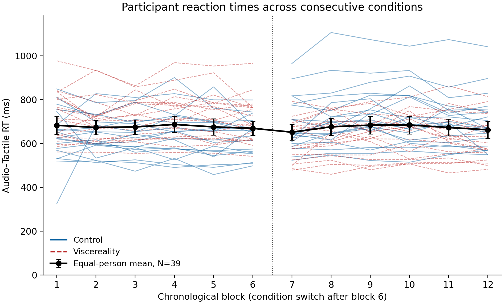

# Does average RT decline across blocks?

**The analysis does not establish a systematic RT decline across the session.**

Exploratory native analysis; original cleaning and primary40. Both conditions occurred consecutively.

N = 39 participants, 8280 retained AT trials. Incomplete-block exclusions: ['P008'].

Blue solid lines are participant block means during Control; red dashed lines show Viscereality. Each person's segments use their actual condition in that part of the session and stop at the switch between blocks 6/7. Black points are equal-person means; intervals are pointwise marginal 95% t CIs, not paired-change CIs. The vertical dotted line marks the switch. No smoothing, normalization or baseline subtraction. Zero-based y-axis. Underlying observations and retained-trial counts: participant_blocks.csv. Owner-requested figure-only amendment: replace the order-group panel with condition-colored participant trajectories; statistical results are unchanged.

| Test | Mean coefficient | 95% t CI | t(38) | Two-sided p | dz | Bootstrap 95% CI |
| --- | ---: | --- | ---: | ---: | ---: | --- |
| linear_ms_per_block | -0.685 | [-3.199, 1.829] | -0.552 | 0.584358 | -0.088 | [-3.057, 1.736] |
| quadratic_ms_per_block_squared | 0.068 | [-0.529, 0.664] | 0.230 | 0.819521 | 0.037 | [-0.569, 0.570] |
| condition_adjusted_ms_per_block | -0.057 | [-2.906, 2.792] | -0.040 | 0.967937 | -0.006 | [-2.742, 2.674] |

Paired block 12 minus block 1: -20.54 ms, 95% CI [-52.22, 11.15]. No separate endpoint p test.

Negative linear coefficients indicate speeding; positive indicate slowing. Quadratic coefficients are in ms/block² and describe curvature, not a monotonic decrease. The condition-adjusted coefficient estimates within-condition change assuming a shared linear slope and a level shift at the switch. Unadjusted exploratory p values for the full three-test family follow the owner's policy; all CIs are pointwise.

## Block means

| Block | Mean ms | SD ms | n | 95% CI ms |
| --- | ---: | ---: | ---: | --- |
| 1 | 682.92 | 123.15 | 39 | [643.00, 722.84] |
| 2 | 673.09 | 101.01 | 39 | [640.35, 705.84] |
| 3 | 675.38 | 100.30 | 39 | [642.87, 707.89] |
| 4 | 686.91 | 112.59 | 39 | [650.42, 723.41] |
| 5 | 675.65 | 114.88 | 39 | [638.41, 712.89] |
| 6 | 669.26 | 98.96 | 39 | [637.18, 701.33] |
| 7 | 651.63 | 111.61 | 39 | [615.45, 687.81] |
| 8 | 676.04 | 120.95 | 39 | [636.83, 715.25] |
| 9 | 683.83 | 123.69 | 39 | [643.73, 723.92] |
| 10 | 684.33 | 125.76 | 39 | [643.57, 725.10] |
| 11 | 673.00 | 116.87 | 39 | [635.11, 710.88] |
| 12 | 662.38 | 116.55 | 39 | [624.60, 700.16] |

The descriptive table above uses the same 39 complete participants at every block. To retain every available person, available_primary40_summary.csv separately includes all 40 primary participants wherever observed (n=39 at block 7, n=40 otherwise). This descriptive companion was added after observing the missing block; the inferential specification was unchanged.

## Sensitivities and limits

- Excluding ['P011']: n=40, linear slope -0.561 ms/block, 95% CI [-3.022, 1.900], p=0.647046. All three tests are retained in results.json.
- Excluding ['P033']: n=40, linear slope -0.561 ms/block, 95% CI [-3.022, 1.900], p=0.647046. All three tests are retained in results.json.

P008 has no retained AT responses in chronological block 7 (18 misses and two hits with missing RT) and is excluded only from complete-block inference; their other block means remain in participant_blocks.csv and the available40 table. P016 has a partial recorded session but usable RTs in every block and is retained. Complete-case inference does not correct informative missing responses or misses. Full42 descriptive means are in results.json; it is not 42 independent recordings. Original participant/trial exclusions and missingness counts are preserved there. Pooling retained trials can reflect changing phase/SOA composition; condition order, practice, carryover and fatigue are not causally separated. Block number is not elapsed time. These results concern overall RT, not a drift-diffusion parameter or a PPS boundary.

All three participant-coefficient Q–Q plots are in diagnostics.png. The linear and adjusted slopes show moderate tail deviations; quadratic coefficients include a strong lower-tail outlier (Shapiro p < .001), making that t approximation particularly uncertain. Bootstrap intervals also include zero. Shapiro p values, leave-one-out mean ranges and fixed-seed whole-person bootstrap CIs are retained in results.json. Normality screens do not establish independence or justify post hoc cleaning. No diagnostic-driven method switch. Specifications, code/data/output hashes and runtime versions accompany the results.

Reproduce: `.venv/Scripts/python.exe for-ai/orchestration/block_rt.py`; independently verify: add `--check`. Native saved outputs are displayed in Segment 3; the historical manuscript is unchanged.
