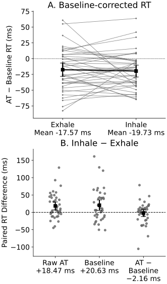

# Segment 2: phase direction checked against literal trial labels

Primary baseline-corrected RT (AT − matched Baseline): Exhale **-17.57 ms**,
Inhale **-19.73 ms**. The corrected phase contrast remains inconclusive.
Raw AT RT is a labelled reference: Exhale 662.19 ms,
Inhale 680.66 ms. Its positive Inhale−Exhale
contrast means slower raw RT during inhale.
It is reproduced directly from the released trial labels without a numeric
phase index, and independently checked against the pandas participant cells.

Grey marks represent the 40 participants; black squares and whiskers are means
and 95% t CIs (39 df). Panel A uses corrected RT and marginal phase-mean CIs. Panel B uses paired
phase-difference CIs: above zero means slower during inhale, below zero faster.
All observations are retained in the axes. No normalization or smoothing.

| Measure | Inhale−Exhale (ms) | Paired 95% CI (ms) | t(39) | Unadjusted two-sided p |
| --- | --- | --- | --- | --- |
| Raw AT | +18.47 | [6.96, 29.98] | 3.246 | 0.002404 |
| Baseline | +20.63 | [5.53, 35.73] | 2.763 | 0.008690 |
| AT − Baseline | -2.16 | [-12.15, 7.82] | -0.438 | 0.663706 |

Baseline RT also increases during inhale. Subtraction therefore leaves a small,
inconclusive phase difference. Segment 0 instead shows Baseline−AT **benefit**
by default: its sign is reversed from corrected RT (AT−Baseline), and larger
benefit does not mean a shorter raw RT. These are distinct questions.

These are the existing exploratory primary40 contrasts, not new tests or fits.
P011/P033 are excluded. All conditions and SOAs receive equal weight within each
person's AT summary; matched baseline pools retained trials within condition/phase.
The original exclusions are unchanged. See [exact settings](SPECIFICATION.md),
[participant values](participant_phases.csv), [statistics/runtime](results.json),
and [the complete native family and sensitivities](https://github.com/GeorgeFejer91/Study5_Publication/blob/main/results/baseline_effects/response_tests.csv).
Paired-t assumptions and the saved difference-score Shapiro diagnostics remain
descriptive limitations; no diagnostic selects a different test or cleaning rule.

**Label limit:** this verifies the direction given the scheduled/instructed phase
labels in the released CSV. No respiratory belt recordings are available here to
verify actual physiology or reconstruct acquisition-side labelling. No new causal
or PPS-boundary claim is made. The browser displays the saved native figure.

Software guidance is acknowledged in the [shared software note](../pps_soa/RESULTS.md#software-guidance).
