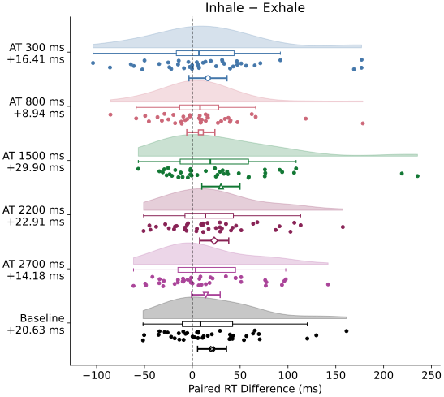

# Segment 2: phase direction by main trial group

Primary baseline-corrected RT (AT − matched Baseline): Exhale **-17.57 ms**,
Inhale **-19.73 ms**. The corrected phase contrast remains inconclusive.
Raw AT RT is a labelled reference: Exhale 662.19 ms,
Inhale 680.66 ms. Its positive Inhale−Exhale
contrast means slower raw RT during inhale.
It is reproduced directly from the released trial labels without a numeric
phase index, and independently checked against the pandas participant cells.

The primary figure shows corrected participant pairs, marginal mean 95% t CIs,
and paired overall contrasts. Its zero references retain all negative values.

## Raw trial-group reference requested by the owner

Panel A shows six raw group-mean phase pairs; colors, markers and line styles
identify the five AT SOAs and pooled Baseline. Panel B uses the same key, shows
every participant's paired delta, with means and pointwise 95% t CIs below the dots
(39 df). Right of zero means slower during inhale; left means faster. No
normalization or smoothing. All plotted observations are retained in the axes.

| Trial group | Exhale M (ms) | Inhale M (ms) | Delta (ms) | Pointwise 95% CI (ms) | n |
| --- | --- | --- | --- | --- | --- |
| AT 300 ms | 673.27 | 689.68 | +16.41 | [-3.49, 36.31] | 40 |
| AT 800 ms | 671.35 | 680.30 | +8.94 | [-5.75, 23.64] | 40 |
| AT 1500 ms | 652.98 | 682.88 | +29.90 | [9.96, 49.84] | 40 |
| AT 2200 ms | 654.76 | 677.66 | +22.91 | [7.71, 38.11] | 40 |
| AT 2700 ms | 658.60 | 672.78 | +14.18 | [-0.76, 29.13] | 40 |
| Baseline | 679.76 | 700.39 | +20.63 | [5.53, 35.73] | 40 |

The six deltas are calculated within each participant before averaging people,
with equal condition weights. Baseline pools retained trials within condition/phase.
The intervals are exploratory and pointwise, not simultaneous; no new six-test
p-value family is added. [Exact group values](participant_trial_groups.csv),
[participant deltas](trial_group_deltas.csv), [summary CSV](trial_group_summary.csv).
Catch trials have no comparable correct-hit target RT and remain excluded.

## Preserved overall reference contrasts

| Measure | Inhale−Exhale (ms) | Paired 95% CI (ms) | t(39) | Unadjusted two-sided p |
| --- | --- | --- | --- | --- |
| Raw AT | +18.47 | [6.96, 29.98] | 3.246 | 0.002404 |
| Baseline | +20.63 | [5.53, 35.73] | 2.763 | 0.008690 |
| AT − Baseline | -2.16 | [-12.15, 7.82] | -0.438 | 0.663706 |

Baseline RT also increases during inhale. Subtraction therefore leaves a small,
inconclusive phase difference. Segment 0 instead shows Baseline−AT **benefit**
by default: its sign is reversed from corrected RT (AT−Baseline), and larger
benefit does not mean a shorter raw RT. These are distinct questions.

The overall reference rows are the existing exploratory primary40 contrasts.
P011/P033 are excluded. All conditions and SOAs receive equal weight within each
person's AT summary; matched baseline pools retained trials within condition/phase.
The original exclusions are unchanged. See [exact settings](SPECIFICATION.md),
[participant values](participant_phases.csv), [statistics/runtime](results.json),
and [the complete native family and sensitivities](https://github.com/GeorgeFejer91/Study5_Publication/blob/main/results/baseline_effects/response_tests.csv).
Paired-t assumptions and the saved difference-score Shapiro diagnostics remain
descriptive limitations; no diagnostic selects a different test or cleaning rule.

**Label limit:** this verifies the direction given the scheduled/instructed phase
labels in the released CSV. No respiratory belt recordings are available here to
verify actual physiology or reconstruct acquisition-side labelling. No new causal
or PPS-boundary claim is made. The browser displays the saved native figure.

Software guidance is acknowledged in the [shared software note](../pps_soa/RESULTS.md#software-guidance).
