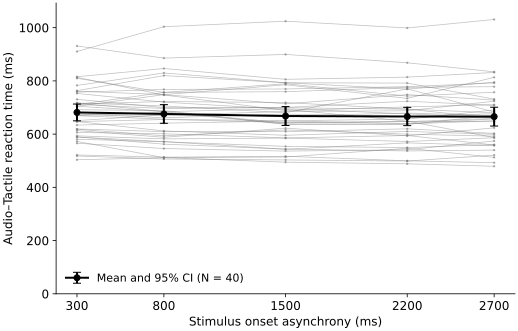

# Segment 1: does RT depend on SOA?

Exploratory basic phenomenon check using **baseline-corrected RT (AT − Baseline)**.
**F(2.52, 98.11) = 3.28, p = .031, η²ₚ = .078, εGG = .629** (Greenhouse–Geisser correction).
N = 40 complete participants; 8478 retained AT trials;
incomplete exclusions: none. P011/P033 excluded.
The omnibus test supports different population mean RTs across SOAs. This is an SOA check, not proof
of a specifically spatial PPS mechanism, sigmoid or physiological boundary.

**Figure 1**

*Baseline-corrected reaction times across stimulus onset asynchronies*

*Note.* Grey lines show each person's five means, averaging the four Condition ×
Phase cells equally. Black points show the equal-person mean with pointwise
marginal 95% t CIs (39 df), not within-person contrast CIs or simultaneous bands.
Subtract each participant × Condition × Phase retained baseline mean (all
baseline SOAs pooled) before averaging. Negative values mean AT responses are
faster than baseline. No normalization or smoothing. Lines are visual guides.
The zero reference and all negative values are retained. Mean intervals describe
the corrected participant scores and include their observed baseline-estimation
variation; they are not conditional trial-level or separately refitted baseline
intervals. [Full settings and limitations](SPECIFICATION.md).

| SOA (ms) | M (ms) | SD (ms) | Median (ms) | n | 95% CI (ms) |
| --- | --- | --- | --- | --- | --- |
| 300 | -8.60 | 46.58 | -3.23 | 40 | [-23.50, 6.29] |
| 800 | -14.25 | 32.34 | -14.74 | 40 | [-24.60, -3.91] |
| 1500 | -22.14 | 30.36 | -26.70 | 40 | [-31.85, -12.43] |
| 2200 | -23.87 | 23.94 | -23.10 | 40 | [-31.52, -16.21] |
| 2700 | -24.38 | 35.57 | -22.57 | 40 | [-35.76, -13.01] |

The descriptive paired endpoint difference, RT(2700) − RT(300), is
-15.78 ms, 95% CI [-31.95, 0.39].
This CI is for the paired difference; no additional endpoint p test was run.
Partial eta squared is a descriptive omnibus effect-size point estimate; no
eta-squared CI is claimed. The endpoint CI supplies magnitude uncertainty in ms.

## Diagnostics and sensitivities

Sphericity is addressed by always using GG correction. Participant pairing and
complete cells are checked, and the known linked pair is excluded. Contrast Q–Q
plots and all four descriptive Shapiro results are retained in `diagnostics.png`
and `results.json`; they do not select a test or change cleaning. Population
sampling independence and physiological interpretation cannot be certified by
normality screens. All sensitivity outcomes are reported, with unadjusted p values:

- Excluded neither linked record: N = 42; F(2.53, 103.89) = 2.85, p = .050, η²ₚ = .065, εGG = .633.
- Excluded ['P011']: N = 41; F(2.53, 101.09) = 3.04, p = .040, η²ₚ = .071, εGG = .632.
- Excluded ['P033']: N = 41; F(2.53, 101.09) = 3.04, p = .040, η²ₚ = .071, εGG = .632.

The Q–Q plots show tail departures, especially for contrast 4. The corrected
ANOVA p value remains an approximate inference; no diagnostic-triggered test
switch or additional cleaning was performed. The endpoint interval includes zero.

Native Python calculation; the browser displays saved, hashed outputs. The
complete `results.zip` includes cell values, settings, statistics and figures.
Independent statsmodels/pandas/covariance checks are in `workbook/test_pps_soa.py`.
Input, source and output hashes and actual runtime versions are in `manifest.json`.
This is a basic SOA check; temporal expectancy/foreperiod explanations remain.

## Raw-RT reference

Raw AT RT is retained explicitly in `raw_reference` in results.json and alongside
the matched baseline and corrected RT in participant_cells.csv. Subtracting one
constant from all SOAs within each participant × condition × phase does not alter
their SOA contrasts under equal-cell averaging. Thus the raw-reference omnibus
statistics and paired endpoint contrast agree with the corrected analysis (within
roundoff), while the means, SDs and marginal CIs differ. The graph and primary
summaries above now use corrected values, as clarified by the owner.

## Software guidance

Statistical and figure review used Scientific Agent Skills: Kassis, T., Agarwal,
V., He, Y., Patel, D., & Brueckner, A. M. (2026). *Scientific Agent Skills: A Library
of Procedural Knowledge for Research Agents*. https://doi.org/10.48550/arXiv.2609.00065
